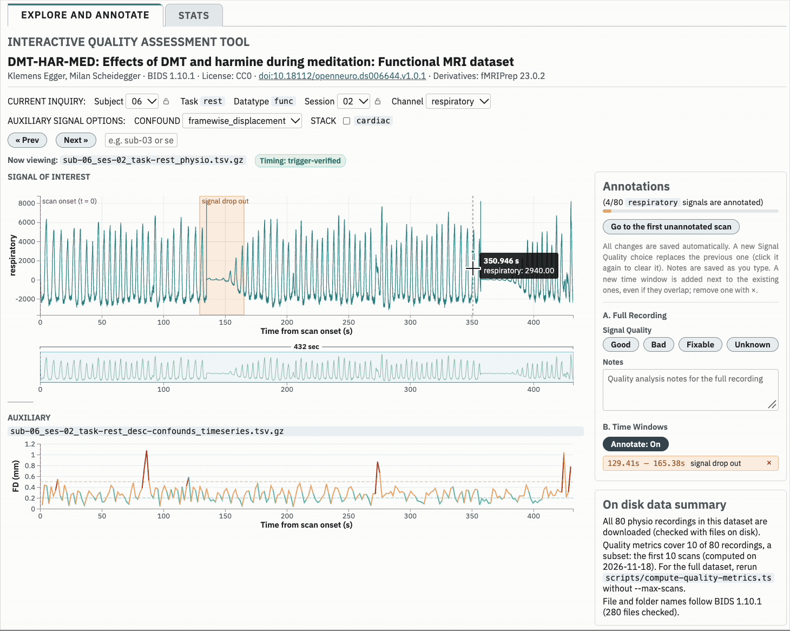

# physAI-QA-interactive

[](https://doi.org/10.5281/zenodo.19389716)

**An interactive visualization and annotation tool for physiological recordings in BIDS-compliant datasets.**

physAI-QA-interactive lets you step through every scan of a BIDS dataset, view cardiac, respiratory and other physiological signals on one time axis, check their timing against scanner trigger pulses, compare them with fMRIPrep or MRIQC head-motion confounds and task events, and mark artifacts as annotations saved next to the dataset. The Stats tab compares signal quality metrics across every scan of a dataset and exports them as a PDF report.

It is part of **physAI**, a research suite for physiological data. This repository, **physAI-QA-interactive**, is the manual data exploration and annotation tool of **physAI-QA**, the suite's quality assurance component. Coming next: **physAI-QA-auto**, for automated artifact detection, annotation and correction.



## Quick start

Requires [Node.js](https://nodejs.org/en/download) 22 (LTS), which comes with npm.

```bash
git clone https://github.com/rgbayrak/physai-qa-interactive.git
cd physai-qa-interactive
npm install
BIDS_ROOT=data/<dataset> npm run dev   # BIDS_ROOT: the main BIDS folder, the one with dataset_description.json
```

Then open the address it prints (usually `http://localhost:5173`) in a desktop web browser.

## Documentation

The full documentation is at **<https://physai-qa-interactive.readthedocs.io>**:

- [Get started](https://physai-qa-interactive.readthedocs.io/en/latest/get-started.html): what you need and how to install it
- [Start the tool](https://physai-qa-interactive.readthedocs.io/en/latest/user-guide/start.html): point it at a dataset; [public datasets](https://physai-qa-interactive.readthedocs.io/en/latest/user-guide/public-datasets.html) to try, and how to download them with DataLad
- [Explore and Annotate](https://physai-qa-interactive.readthedocs.io/en/latest/user-guide/explore-and-annotate.html) and [Stats](https://physai-qa-interactive.readthedocs.io/en/latest/user-guide/quality-metrics.html): what each tab shows
- [Inputs and outputs](https://physai-qa-interactive.readthedocs.io/en/latest/user-guide/inputs-and-outputs.html): the folders it reads and where it saves annotations, peaks and quality metrics
- [Troubleshooting](https://physai-qa-interactive.readthedocs.io/en/latest/user-guide/troubleshooting.html)
- [Release notes](https://physai-qa-interactive.readthedocs.io/en/latest/release-notes.html)

## Contributing

Architecture, server API, the chart library's API reference and how to add a metric are in [CONTRIBUTING.md](docs/CONTRIBUTING.md), and the user study sheet is [docs/user-guide/user-study.md](docs/user-guide/user-study.md).

## Citation

If you use this software, please cite it using its DOI: [10.5281/zenodo.19389716](https://doi.org/10.5281/zenodo.19389716). GitHub's **Cite this repository** button (from [CITATION.cff](CITATION.cff)) gives APA and BibTeX formats.

## AI disclosure

Code in this repository was generated with Anthropic's Claude (Claude Opus 5.5, via Claude Code). The lead author reviewed and manually approved all changes.

## License

Released under the [MIT License](LICENSE).
