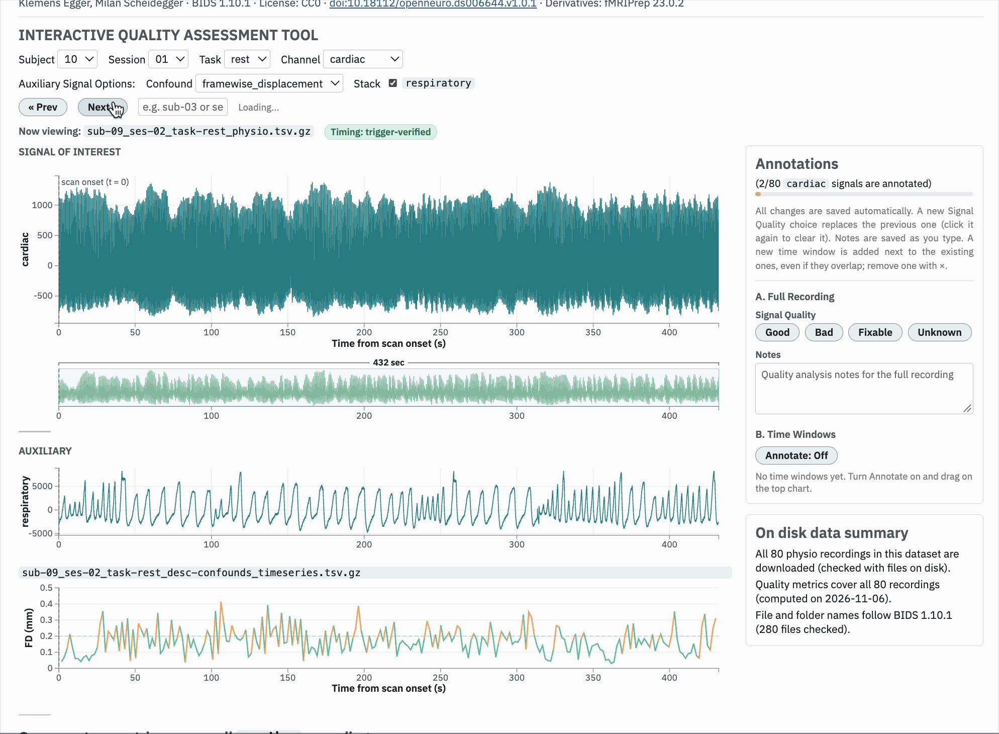

# physAI-QA-interactive

physAI-QA-interactive is an interactive tool for exploring, and annotating physiological recordings in BIDS-compliant datasets.

It lets you navigate through every scan in a dataset and visualize cardiac, respiratory, and other physiological signals along a shared time axis, aligned to scan onset. You can verify signal alignment using scanner trigger pulses, compare physiological recordings with fMRIPrep or MRIQC head-motion confounds and task events, calculate signal quality metrics for individual channels, and annotate artifacts directly in the recordings. Annotations are saved alongside the dataset.

The Stats tab provides a dataset-wide view of signal quality, allowing you to compare metrics across scans and export the results as a PDF report.

physAI-QA-interactive is part of physAI, a research suite for physiological data. It serves as the manual exploration and annotation interface within physAI-QA, the suite's manual quality assessment component.



- **How does it fit together?** The {doc}`overview` shows the typical workflow, step by step.
- **New here?** Start with {doc}`get-started`: what the tool is for, what you need, and how to install it.
- **Using the tool?** The {doc}`user-guide/index` explains each part of the interface and what it shows.
- **Unfamiliar term?** See the {doc}`glossary`.
- **Want to contribute?** {doc}`CONTRIBUTING` covers the code layout, the server and the chart library.

```{toctree}
:maxdepth: 2
:hidden:

overview
get-started
user-guide/index
glossary
CONTRIBUTING
```
